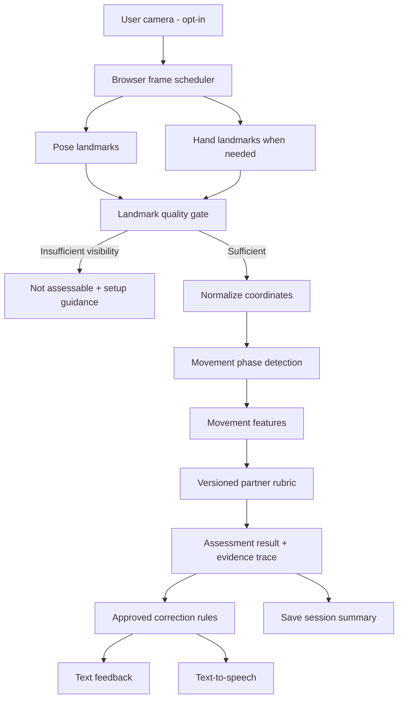

# AI Movement Assessment - Technical and Pedagogical Specification

## 1. Purpose

Build an explainable practice aid for a narrow set of partner-approved solo beginner movements. The system should help a learner understand observable differences from an approved reference and practice again. It is not a combat simulator or formal grading authority.

## 2. Proposed pipeline



## 3. Landmark options

### Pose Landmarker

Google AI Edge documentation describes Pose Landmarker for images, video, and live camera streams. It outputs 33 pose landmarks, with normalized image coordinates and world coordinates. It can support posture and joint-angle analysis.

Official docs: https://developers.google.com/edge/mediapipe/solutions/vision/pose_landmarker?tab=Web

### Hand Landmarker

Google AI Edge documentation describes 21 hand landmarks per detected hand and handedness. This can support analysis of hand configuration where the camera view provides enough visibility.

Official docs: https://developers.google.com/edge/mediapipe/solutions/vision/hand_landmarker?tab=Web

### Holistic Landmarker

Holistic combines pose, hands, and face landmarks. Face landmarks are not needed for the first MVP unless the partner-approved rubric has a clear, justified use for them. Prefer Pose + Hand to minimize unnecessary personal/biometric-like information.

Official docs: https://developers.google.com/edge/mediapipe/solutions/vision/holistic_landmarker

## 4. MVP assessment method

Start with a transparent rule-based baseline rather than training a new model immediately.

1. Load the approved movement reference and rubric version.
2. Start camera only after explicit permission.
3. Infer pose/hand landmarks in the browser.
4. Check detection confidence, required body parts, frame coverage, and camera orientation.
5. Normalize coordinates for translation and scale where appropriate; do not over-normalize away meaningful stance width/height differences.
6. Detect movement phase using approved phase boundaries or a simple temporal rule.
7. Compute only instructor-approved features such as joint angles, relative alignment, hand shape features, phase order, and timing.
8. Compare with instructor-approved tolerances/variations.
9. Return component statuses, explanation, confidence/quality, and correction IDs.
10. Persist summary and version metadata; do not persist raw video by default.

## 5. Feature candidates

- Joint angles: shoulder, elbow, hip, knee, ankle/foot orientation where landmark quality supports it.
- Relative geometry: elbow relative to shoulder, knee relative to ankle/hip, stance width normalized by body scale.
- Hand configuration: finger landmark distances/angles for a partner-approved hand shape; be cautious with occlusion and motion blur.
- Temporal sequence: phase order, transition timing, approximate movement duration.
- Stability: variation of hip/torso/ankle landmarks over a defined hold interval; do not claim force or physical balance measurement beyond observable proxy.

## 6. Quality gate

Return `not_assessable` rather than score when any required condition fails:
- required body landmarks not visible;
- hand landmarks required but hand is occluded;
- user is too close/far or body parts leave the frame;
- confidence falls below a threshold set during validation;
- camera orientation does not match the reference protocol;
- more than one person is detected in the practice zone;
- lighting/frame rate is inadequate;
- the movement is not supported by the active rubric version.

The UI must explain how to fix the capture condition. Missing landmarks are not “wrong movement”.

## 7. Scoring and rubric versioning

Do not hard-code arbitrary weights such as a generic 60/25/15. Each partner movement has a rubric defined and approved by an instructor. The rubric must include:
- criteria and definitions;
- measurement method;
- allowed variation/tolerance;
- phase applicability;
- weight (if a weighted score is approved);
- correction text/audio;
- whether the criterion is observable from webcam;
- version and approval record.

Store the `rubric_version_id` and `reference_version_id` on every result. If the rubric changes, do not silently compare historical scores from different versions.

## 8. Feedback engine

Use a deterministic correction library linked to instructor-approved rule IDs. A generative model may help rewrite approved content in simpler language only if it cannot create new technical claims. The source rule ID and approved text must remain traceable.

Example structure:
```json
{
  "status": "needs_correction",
  "component": "front_knee_alignment",
  "phase_id": "phase_02",
  "rule_id": "RULE-STANCE-004",
  "message_id": "FEEDBACK-STANCE-004",
  "severity": "minor",
  "confidence": 0.87,
  "rubric_version": "v1.0"
}
```

Do not ship this example as an actual rule until an instructor has approved it.

## 9. Evaluation strategy

### Model/feature evaluation
- Per-movement precision/recall/F1 if classification exists.
- Confusion matrix and macro-F1 for imbalanced movement sets.
- Landmark visibility/success rate.
- Angle MAE only where a trustworthy reference measurement exists.
- Not-assessable rate.
- Latency, FPS, frame-drop rate.
- Device/camera/lighting robustness.

### Agreement with instructors
- Use at least two instructors if available.
- Record inter-rater agreement first.
- Compare AI with adjudicated instructor reference; consider ICC or rank correlation depending on the score scale and study design.
- Report confidence intervals and per-movement results.

### Generalization
- Split by participant identity, not frame alone.
- Hold out participants and (where feasible) camera/device conditions.
- Keep a partner/style scope; do not claim cross-style generalization from one style's dataset.

## 10. Performance and browser implementation

- Camera lifecycle must be managed in a dedicated service/hook with robust cleanup.
- Stop every MediaStream track on stop, route change, unmount, error, and logout.
- Avoid running inference on every display frame if the device cannot sustain it; use a controlled scheduler and drop stale frames.
- MediaPipe Web calls can run synchronously and may block the main thread; consider Web Worker/off-thread processing after validating the integration.
- Use a stable timestamp for video inference.
- Handle model loading progress and offline/failed model load.
- Test Chrome/Safari/Edge versions on the actual target devices.

## 11. What ordinary RGB webcam cannot reliably assess

Do not infer:
- striking force or impact;
- combat effectiveness;
- intent/aggression;
- pain/injury state;
- formal rank or mastery;
- all artistic/spiritual qualities;
- safety of the practice space beyond visible cues;
- hidden/occluded limb geometry.

These require human observation or additional instrumentation and expert judgement.

## 12. Safety and UX rules

- Only safe, partner-approved solo beginner movements in MVP.
- No sparring, contact drills, weapons, throws, high-impact actions, or acrobatics.
- Always provide pause/stop and “stop if pain/discomfort” instructions.
- Keep feedback constructive and non-shaming.
- Provide text equivalent for voice feedback.
- Never represent an AI score as a formal school/competition score.
