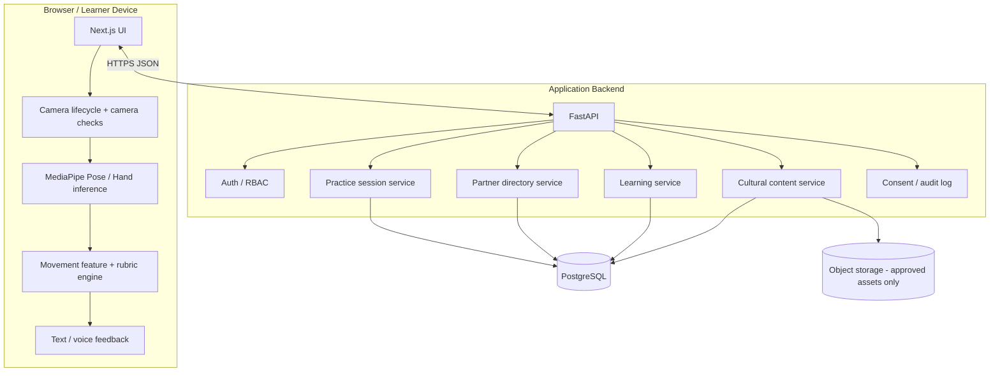

# Technical Architecture - SILATARA

## 1. Architecture goals

- Browser-first AI practice for low latency and data minimization.
- Clear separation between cultural content, learning logic, CV inference, assessment rules, and application APIs.
- Movement/rubric versioning so historical results remain interpretable.
- A small deployable MVP, not a premature microservice system.
- Testable assessment logic independent of React components.

## 2. Recommended default stack

| Layer | Default | Notes |
|---|---|---|
| Web frontend | Next.js App Router + TypeScript | Use official current Next.js docs and inspect existing repo before changing. |
| UI styling | Tailwind CSS + accessible primitives (Radix/shadcn-style) | Keep reusable components and design tokens. |
| Icons | Lucide | No emoji icons in product UI. |
| Client CV | `@mediapipe/tasks-vision` | Pose and Hand tasks; use only necessary landmarks. |
| Assessment logic | TypeScript pure modules initially | Easier to execute in browser and unit test. |
| API backend | Python FastAPI | Application APIs, auth integration, partner/content workflows, persistence. |
| Data validation | Pydantic | API request/response schemas. |
| Database | PostgreSQL | Relational provenance, partners, rubrics, sessions, access. |
| ORM/migrations | SQLAlchemy + Alembic | Use a consistent migration discipline. |
| Object storage | S3-compatible provider | Only approved public assets or user-consented uploads. |
| Local dev | Docker Compose | Postgres and optional storage emulator. |
| Frontend tests | Vitest + React Testing Library | Unit and component tests. |
| E2E | Playwright | Core user journey and responsive UI. |
| Backend tests | pytest | API/service/permission tests. |

Do not upgrade or replace dependencies blindly. Confirm current project state and official compatibility documentation. The included Next.js official docs show the App Router as the current recommended route for a new application.

## 3. High-level components



## 4. Camera and inference data flow

Default privacy design:
1. Browser obtains permission only after user clicks `Mulai kamera`.
2. Video frames stay on the device for local inference.
3. Pose/hand landmarks are processed in memory.
4. The assessment engine calculates a summary and component feedback.
5. Only session summary, component results, rubric/reference versions, and limited technical telemetry are sent to the backend.
6. Raw frames/video are not persisted by default.
7. If a future experiment requires video upload, it requires a separate explicit consent, stated purpose, retention period, access policy, and deletion workflow.

## 5. Suggested repository structure

Claude Code must adapt this to the existing repository; do not force-restructure existing code without an audit.

```text
silatara/
├── CLAUDE.md
├── AGENTS.md
├── README.md
├── docs/
├── apps/
│   └── web/                     # Next.js application
│       ├── src/app/
│       ├── src/components/
│       ├── src/features/
│       │   ├── heritage/
│       │   ├── academy/
│       │   ├── practice/
│       │   ├── progress/
│       │   └── community/
│       ├── src/lib/
│       └── tests/
├── services/
│   └── api/                     # FastAPI service
│       ├── app/api/
│       ├── app/core/
│       ├── app/models/
│       ├── app/schemas/
│       ├── app/services/
│       ├── app/repositories/
│       ├── migrations/
│       └── tests/
├── packages/
│   ├── contracts/               # Shared API/type contracts if needed
│   └── assessment/              # Pure movement features/rubric engine if shared
├── reference-materials/
├── infra/
│   └── docker-compose.yml
├── .env.example
└── pnpm-workspace.yaml           # only if monorepo is chosen
```

Do not create a monorepo merely because this diagram shows one. Use the simplest structure appropriate to the current repo/team.

## 6. Authentication and authorization

Roles:
- `learner`
- `instructor`
- `partner_admin`
- `content_editor`
- `platform_admin`

Authorization rules:
- Learners can read public approved content and their own sessions/profile.
- Instructors can review content and rubrics assigned to their partner scope.
- Partner admins can manage their own public partner profile and submit content updates; they cannot approve their own content without required review if policy requires separation.
- Content editors can draft/review content but cannot bypass partner permission status.
- Platform admins have scoped privileged actions that are audit logged.

Choose the authentication provider only after assessing team skill, cost, data location, and security. Do not build insecure custom auth casually. For prototypes, a clearly labelled mock-auth mode may be used, but it must not be mistaken for production authentication.

## 7. API and data boundaries

- Backend owns user identity, content permissions, partners, learning enrolment, practice-session summaries, and audit records.
- Client owns raw camera stream lifecycle and on-device inference.
- Client assessment code should be deterministic and versioned; backend validates the request and stores the record.
- If a future server-side model is used, it needs explicit data flow, security, and privacy review.

## 8. Deployment approach

### Local
- Web frontend.
- FastAPI backend.
- PostgreSQL.
- Optional S3-compatible local object storage.
- Seed data labelled as demo, not real partner data.

### Staging
- HTTPS required for camera permissions.
- Separate database and object-storage bucket from production.
- Synthetic/demo data only until rights/consents are signed.
- Automated migrations and backup checks.

### Production
- HTTPS, secure cookies, secret manager, least-privilege service accounts.
- Database backup/restore test.
- Monitoring for API errors and inference failures.
- No raw video storage by default.
- Content publication requires approval status and rights metadata.

## 9. Observability

Log:
- request IDs and API errors;
- model/inference version;
- movement/rubric/reference IDs;
- assessment status (valid/not assessable/error);
- anonymized device/browser category and performance metrics where consent/legal basis permits.

Do not log raw video, access tokens, secrets, unnecessary full names, or sensitive interview content.

## 10. Architecture decisions to record

Create ADRs for:
- auth provider and session model;
- browser-only vs server-side inference;
- rubric/assessment format;
- database schema and storage;
- how partner approvals are represented;
- telemetry/privacy boundaries;
- monorepo vs separate frontend/backend projects.
